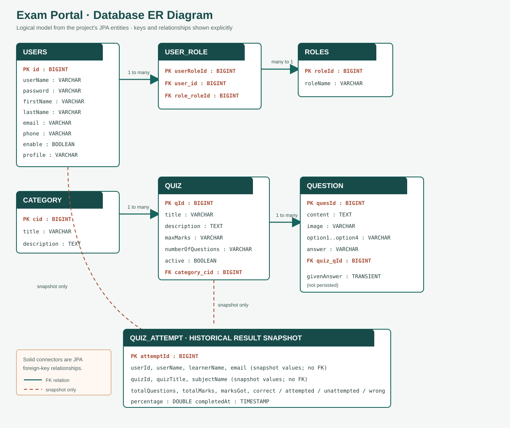
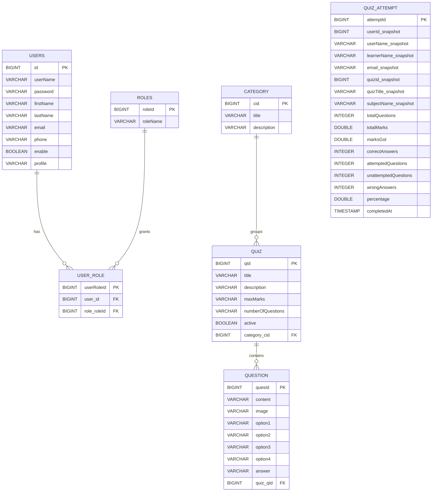

# Exam Portal Database ER Diagram

This diagram is based on the JPA entities and relationship annotations in `examServer/src/main/java`.

The SVG above is a standalone diagram image. The Mermaid source below is retained for editing and rendering in Markdown viewers that support Mermaid.

## Relationships

- A user can have multiple role-link rows. Each `USER_ROLE` row references exactly one user and one role. This is the join entity implementing the many-to-many user/role assignment.
- A category can group many quizzes. Each quiz references one category through its `category` relationship.
- A quiz can contain many questions. Each question references one quiz through its `quiz` relationship.
- A quiz attempt belongs logically to a user and quiz, but `QuizAttempt` stores `userId` and `quizId` as ordinary scalar columns, not database foreign keys. The remaining user, quiz, and subject values are snapshots. Therefore no FK relationship line is drawn from `QUIZ_ATTEMPT`.

## Implementation notes

- The physical table names explicitly declared by JPA are `users`, `roles`, `category`, `quiz`, `question`, and `quiz_attempt`. `UserRole` has no explicit `@Table`; under the configured Hibernate naming strategy it is normally created as `user_role`.
- `Question.givenAnswer` is marked `@Transient`; it is used while taking a quiz and is not stored in the `question` table.
- Passwords are stored in the `users.password` column as BCrypt hashes.
- Question and quiz content/descriptions allow longer text than a typical short `VARCHAR`; exact SQL column types and lengths can vary by the configured MySQL dialect and Hibernate version.
- Schema generation is currently `spring.jpa.hibernate.ddl-auto=update`. Treat the diagram as the logical application model; confirm the actual live schema before production migrations.
